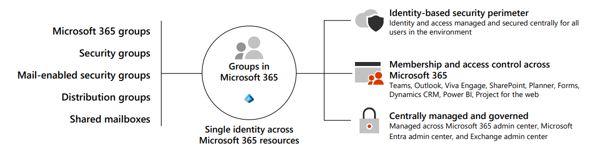
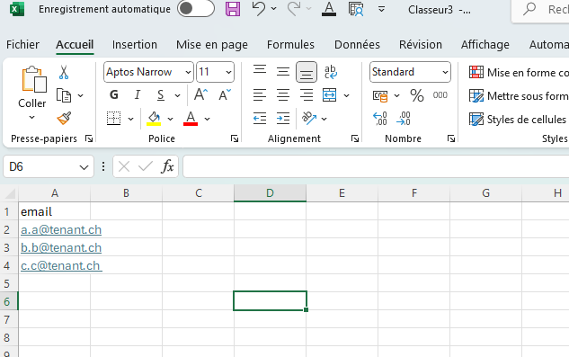
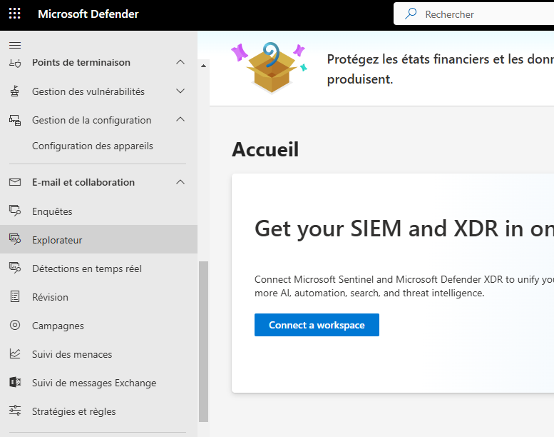
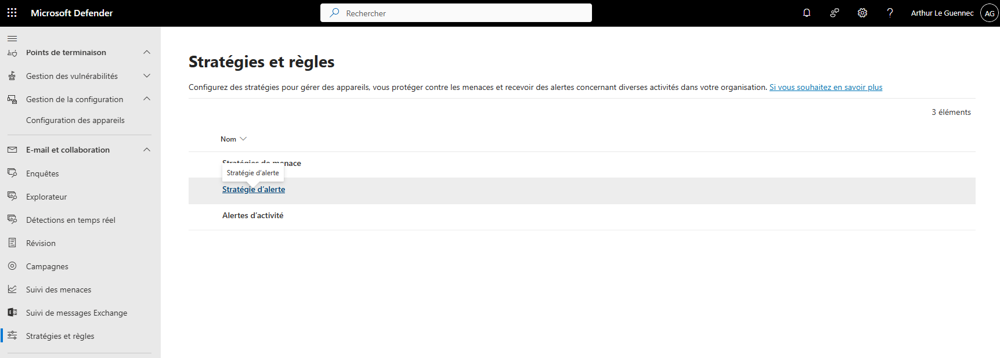
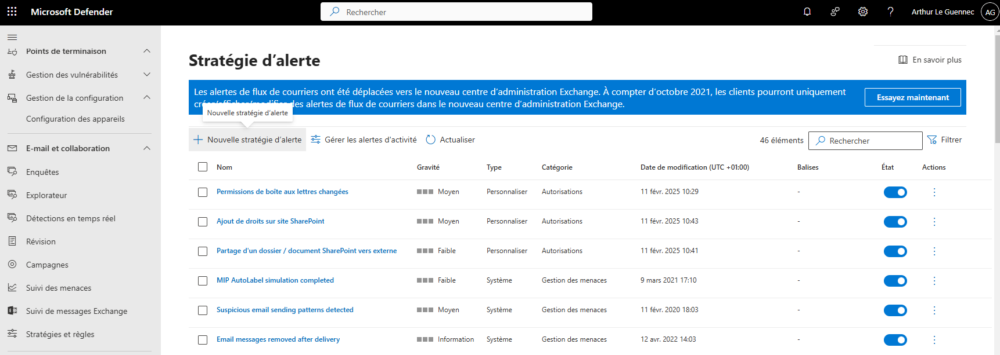

====================
Microsoft 365
====================

Création de tenant
====================

Microsoft 365
================

Entra ID
---------------

Gestion des utilisateurs et groupes
^^^^^^^^^^^^^^^^^^^^^^^^^^^^^^^^^^^^^^

Utilisateurs
~~~~~~~~~~~~~~~~~~~~~~~~~~~~

Différents types de groupes
~~~~~~~~~~~~~~~~~~~~~~~~~~~~~~~~~

+-------------------------------+-----------------------------------------------------------------------------------------------------------------------------------------------------------------------------------------------------------------------------------------------------------------------------------------------------------------------------------------------------------------------------------------------------------------------------------------------------------------------------------------------------------------------------------------------------+----------------------------------------------------------------------------------------------------------------------------+-----------------------------------------------------+
| Group Type                    | Description                                                                                                                                                                                                                                                                                                                                                                                                                                                                                                                                         | When to use?                                                                                                               | Where to create it?                                 |
+-------------------------------+-----------------------------------------------------------------------------------------------------------------------------------------------------------------------------------------------------------------------------------------------------------------------------------------------------------------------------------------------------------------------------------------------------------------------------------------------------------------------------------------------------------------------------------------------------+----------------------------------------------------------------------------------------------------------------------------+-----------------------------------------------------+
| Microsoft   365 group         | A Microsoft 365 group is the recommended group type. It   includes a group email and shared workspaces, making it ideal for   collaboration. It's similar to distribution groups because it has its own   mailbox, and its members receive email messages sent to the group. However,   it differs from distribution groups in that it allows teams to collaborate by   providing them with a shared workspace for email, conversations, files, and   calendar events.                                                                              | When you want to provide distribution list capabilities   and other collaboration features. The best option for team work. | - Microsoft 365 admin center                        |
|                               |                                                                                                                                                                                                                                                                                                                                                                                                                                                                                                                                                     |                                                                                                                            | - Outlook (also known as the Groups app in Outlook) |
|                               |                                                                                                                                                                                                                                                                                                                                                                                                                                                                                                                                                     |                                                                                                                            | - Exchange admin center                             |
|                               |                                                                                                                                                                                                                                                                                                                                                                                                                                                                                                                                                     |                                                                                                                            | - Microsoft Entra admin center                      |
|                               |                                                                                                                                                                                                                                                                                                                                                                                                                                                                                                                                                     |                                                                                                                            | - Microsoft 365 admin app                           |
+-------------------------------+-----------------------------------------------------------------------------------------------------------------------------------------------------------------------------------------------------------------------------------------------------------------------------------------------------------------------------------------------------------------------------------------------------------------------------------------------------------------------------------------------------------------------------------------------------+----------------------------------------------------------------------------------------------------------------------------+-----------------------------------------------------+
| Distribution   group          | In Microsoft 365, a distribution group is also known as a   distribution list. Organizations primarily use it for sending notifications   to a group of people. You do so by associating a single email address with   the distribution group. An organization's email system or mail server   distributes messages sent to the group's email address to all members of the   group.                                                                                                                                                                | When you want to distribute messages using the group   only.                                                               | - Microsoft 365 admin center                        |
|                               |                                                                                                                                                                                                                                                                                                                                                                                                                                                                                                                                                     |                                                                                                                            | - Microsoft 365 admin app                           |
|                               |                                                                                                                                                                                                                                                                                                                                                                                                                                                                                                                                                     |                                                                                                                            | - Exchange admin center                             |
+-------------------------------+-----------------------------------------------------------------------------------------------------------------------------------------------------------------------------------------------------------------------------------------------------------------------------------------------------------------------------------------------------------------------------------------------------------------------------------------------------------------------------------------------------------------------------------------------------+----------------------------------------------------------------------------------------------------------------------------+-----------------------------------------------------+
| Mail-enabled   security group | When you mail-enable a security group, it means the group   has an associated email address, and members of the group can send and   receive emails using that address. This design enables the group to function   as a mailing list or distribution group. Message delivery works the same as   with a distribution group. In other words, an organization's email system or   mail server distributes messages sent to the security group's email address   to all members of the group.                                                         | When you want to use the group for both permissions and   mail distribution.                                               | - Microsoft 365 admin   center                      |
|                               |                                                                                                                                                                                                                                                                                                                                                                                                                                                                                                                                                     |                                                                                                                            | - Microsoft 365 admin app                           |
|                               |      You can also use a mail-enabled security group to assign group permissions   to various resources, such as SharePoint. For example, by adding a   mail-enabled security group to SharePoint, you can grant the group's members   access permissions to SharePoint sites, libraries, lists, or individual items   within SharePoint. Mail-enabled security groups can't be dynamically managed,   nor can they contain devices.                                                                                                                 |                                                                                                                            | - Exchange admin center                             |
+-------------------------------+-----------------------------------------------------------------------------------------------------------------------------------------------------------------------------------------------------------------------------------------------------------------------------------------------------------------------------------------------------------------------------------------------------------------------------------------------------------------------------------------------------------------------------------------------------+----------------------------------------------------------------------------------------------------------------------------+-----------------------------------------------------+
| Security   group              | A security group provides a convenient way to manage and   assign permissions to multiple users simultaneously. A security group can   grant access permissions to resources such as OneDrive and SharePoint.                                                                                                                                                                                                                                                                                                                                       | When you only require a group to grant permissions.                                                                        | - Microsoft 365 admin center                        |
|                               |                                                                                                                                                                                                                                                                                                                                                                                                                                                                                                                                                     |                                                                                                                            | - Microsoft 365 admin app                           |
|                               |                                                                                                                                                                                                                                                                                                                                                                                                                                                                                                                                                     |                                                                                                                            | - Microsoft Entra admin center                      |
+-------------------------------+-----------------------------------------------------------------------------------------------------------------------------------------------------------------------------------------------------------------------------------------------------------------------------------------------------------------------------------------------------------------------------------------------------------------------------------------------------------------------------------------------------------------------------------------------------+----------------------------------------------------------------------------------------------------------------------------+-----------------------------------------------------+
| Dynamic   distribution group  | A dynamic distribution group automatically manages its   membership based on predefined criteria or filters. In a traditional   distribution group, users manually manage membership. In a dynamic   distribution group, Microsoft 365 dynamically updates its member list based   on specific attributes or conditions.                                                                                                                                                                                                                            | When you want to have a flexible distribution list that   changes membership automatically.                                | - Exchange admin center                             |
|                               |                                                                                                                                                                                                                                                                                                                                                                                                                                                                                                                                                     |                                                                                                                            |                                                     |
|                               |      You create and manage dynamic distribution groups in Exchange Online. With   Exchange Online, administrators can define the criteria or rules for dynamic   distribution groups using PowerShell or the Exchange admin center. They can   base these rules on user attributes such as department, location, job title,   or custom attributes. Microsoft 365 automatically calculates and updates the   membership of the dynamic distribution group based on these rules.                                                                     |                                                                                                                            |                                                     |
+-------------------------------+-----------------------------------------------------------------------------------------------------------------------------------------------------------------------------------------------------------------------------------------------------------------------------------------------------------------------------------------------------------------------------------------------------------------------------------------------------------------------------------------------------------------------------------------------------+----------------------------------------------------------------------------------------------------------------------------+-----------------------------------------------------+
| Shared   mailbox              | Shared mailboxes are used when multiple people need   access to the same mailbox, such as a company information or support email   address, reception desk, or other function that might be shared by multiple   people. Users with permissions to the group mailbox can send as or send on   behalf of the mailbox email address if the administrator has given that user   permissions to do that. This feature is useful for help and support mailboxes   because users can send emails from "Contoso Support" or "Building   A Reception Desk." | When multiple people need to access the same mailbox,   such as a support email address.                                   | - Microsoft 365 admin center                        |
|                               |                                                                                                                                                                                                                                                                                                                                                                                                                                                                                                                                                     |                                                                                                                            | - Microsoft 365 admin app                           |
|                               |                                                                                                                                                                                                                                                                                                                                                                                                                                                                                                                                                     |                                                                                                                            | - Microsoft Entra admin center                      |
+-------------------------------+-----------------------------------------------------------------------------------------------------------------------------------------------------------------------------------------------------------------------------------------------------------------------------------------------------------------------------------------------------------------------------------------------------------------------------------------------------------------------------------------------------------------------------------------------------+----------------------------------------------------------------------------------------------------------------------------+-----------------------------------------------------+

Conditional Access Policies
^^^^^^^^^^^^^^^^^^^^^^^^^^^^^^^^^^^^^^

.. important::
   
   Afin de pouvoir utiliser les Conditional Access Policies, il est d'abord nécessaire de désactiver les Security Defaults du tenant.

   Entra ID > Overview > Properties > Security Defaults

   .. image:: https://raw.githubusercontent.com/algues111/docs-sysadmin/main/docs/source/images/MS365/security-defaults.png

Export des dernières connexions des utilisateurs
^^^^^^^^^^^^^^^^^^^^^^^^^^^^^^^^^^^^^^^^^^^^^^^^^^

Via MSGraph
~~~~~~~~~~~~

.. code-block:: console

   Connect-MgGraph -Scopes Directory.Read.All,AuditLog.Read.All
   Get-MgUser -All -Property 'UserPrincipalName', 'SignInActivity' | Select-Object UserPrincipalName, @{N='LastSignInDate';E={$_.SignInActivity.LastSignInDateTime}} | Export-Csv -Path C:\\Windows\\temp\\LastLogininfo.csv -NoTypeInformation

Compromission de compte (device code + appareil enregistré)
^^^^^^^^^^^^^^^^^^^^^^^^^^^^^^^^^^^^^^^^^^^^^^^^^^^^^^^^^^^^^^

Scénario type : l'utilisateur reçoit un lien de partage (SwissTransfer, WeTransfer, faux SharePoint...) vers un PDF
qui demande de « se connecter ». La page affiche un code et redirige vers la **vraie** page ``microsoft.com/devicelogin``.
L'utilisateur saisit le code et valide sa MFA : l'attaquant récupère le token.

Avec ce token, l'attaquant enregistre un appareil dans Entra ID (→ **PRT**, persistance qui survit à un reset de mot de passe),
se connecte à OWA et crée une règle de boîte pour cacher les mails d'un partenaire → **préparation de fraude au virement (BEC)**.

.. important::

   La MFA ne protège pas contre ce scénario : c'est l'utilisateur lui-même qui la valide.
   Un simple reset de mot de passe ne suffit pas.

Indicateurs
~~~~~~~~~~~~~

Dans les sign-in logs Entra (interactifs **et** non interactifs) et l'audit Purview (UAL) :

- Connexion à **Microsoft Authentication Broker** avec protocole **Device code flow** (``RequestType = Cmsi:Cmsi`` dans l'UAL).
- Quelques secondes après, depuis une autre IP : **Device Registration Client** → **Device Registration Service** (événement « Register device » dans l'audit Entra).
- Appareil inconnu, ``TrustType`` = Entra registered. Nom qui imite un PC Windows (ex. ``DESKTOP-`` + 8 caractères : Windows n'en génère que 7).
- Connexions OfficeHome / OWA depuis un hébergeur cloud (AWS, Azure...) dans le même pays pour éviter les alertes géographiques.
- ``New-InboxRule`` au nom vide ou bidon (``-``, ``.``) : expéditeur contient ``@partenaire.example`` → supprimer, marquer comme lu, arrêter les règles.

Chronologie type
~~~~~~~~~~~~~~~~~~

.. list-table::
   :widths: 15 20 65
   :header-rows: 1

   * - Heure
     - IP
     - Événement
   * - T0 - 2h30
     - —
     - Prise de contact (réunion Teams avec un invité anonyme, mail « commercial »...)
   * - T0
     - ``<IP utilisateur>``
     - Saisie du device code + MFA (Authentication Broker, Cmsi)
   * - T0 + 12 s
     - ``<IP attaquant 1>``
     - Enregistrement de l'appareil ``<DeviceName>`` / ``<DeviceId>`` → PRT
   * - T0 + 18 min
     - ``<IP attaquant 2>`` (cloud)
     - Connexion OfficeHome puis OWA avec l'appareil, ``MailItemsAccessed``
   * - T0 + 19 min
     - ``<IP attaquant 2>``
     - ``New-InboxRule`` ciblant le partenaire

.. note::

   Les heures des logs sont en **UTC**. L'UAL ne contient pas les connexions non interactives : un usage du token via Graph
   n'y apparaît pas, d'où l'intérêt de croiser avec les sign-in logs Entra.

Vérifier l'appareil
~~~~~~~~~~~~~~~~~~~~~

Si l'utilisateur affirme que c'est son PC, comparer le **DeviceId**, pas le nom.

Sur le poste : ``dsregcmd /status`` → DeviceId (sections Device Details / Workplace Join).

.. code-block:: powershell

   Connect-MgGraph -Scopes Device.ReadWrite.All,User.ReadWrite.All,UserAuthenticationMethod.ReadWrite.All,DelegatedPermissionGrant.ReadWrite.All

   Get-MgUserRegisteredDevice -UserId user@contoso.com
   Get-MgDevice -Filter "deviceId eq '<DeviceId>'" |
     fl DisplayName,Id,DeviceId,TrustType,OperatingSystemVersion,RegistrationDateTime,ApproximateLastSignInDateTime

- Créé à T0 et absent du poste → appareil de l'attaquant.
- Présent sur le poste → **poste compromis** (vol de PRT par infostealer, prise en main à distance). Isoler, scan EDR, vérifier
  les outils d'accès distant (Quick Assist, AnyDesk...), réinstaller si besoin.

Remédiation
~~~~~~~~~~~~~

Dans cet ordre :

**1. Supprimer l'appareil puis révoquer les sessions**

.. code-block:: powershell

   Remove-MgDevice -DeviceId <ObjectId>
   Revoke-MgUserSignInSession -UserId user@contoso.com

**2. Reset du mot de passe** (Entra ID > Utilisateurs > Réinitialiser le mot de passe).

**3. Méthodes MFA** : supprimer tout ce que l'utilisateur ne reconnaît pas (Authenticator, passkey, Windows Hello).

.. code-block:: powershell

   Get-MgUserAuthenticationMethod -UserId user@contoso.com | fl Id,AdditionalProperties

   Remove-MgUserAuthenticationMicrosoftAuthenticatorMethod -UserId user@contoso.com -MicrosoftAuthenticatorAuthenticationMethodId <Id>
   Remove-MgUserAuthenticationFido2Method -UserId user@contoso.com -Fido2AuthenticationMethodId <Id>

**4. Consentements OAuth** : une app consentie garde son accès après un reset.

.. code-block:: powershell

   Get-MgUserOauth2PermissionGrant -UserId user@contoso.com | fl Id,ClientId,ResourceId,Scope
   Remove-MgOauth2PermissionGrant -OAuth2PermissionGrantId <Id>

**5. Règles de boîte et transferts**

L'EAC ne gère pas les règles des utilisateurs : PowerShell (ou Azure Cloud Shell avec ``Connect-ExchangeOnline -Device``),
sinon OWA de l'utilisateur > Paramètres > Courrier > Règles (sans les règles cachées).

Une règle nommée ``-`` passe mal en ``-Identity`` : filtrer sur le nom.

.. code-block:: powershell

   Connect-ExchangeOnline

   Get-InboxRule -Mailbox user@contoso.com -IncludeHidden |
     fl Name,Identity,Enabled,From*,DeleteMessage,MarkAsRead,MoveToFolder,ForwardTo,RedirectTo

   Get-InboxRule -Mailbox user@contoso.com -IncludeHidden |
     Where-Object { $_.Name -eq '-' } |
     Remove-InboxRule -Confirm:$false

   Get-Mailbox user@contoso.com | fl ForwardingSmtpAddress,ForwardingAddress,DeliverToMailboxAndForward

**6. Récupérer les mails cachés** : ils sont dans les Éléments supprimés, marqués comme lus. Les montrer à l'utilisateur.

.. code-block:: powershell

   Get-MessageTraceV2 -RecipientAddress user@contoso.com -StartDate "<T0 UTC>" -EndDate (Get-Date) |
     Where-Object { $_.SenderAddress -like '*@partenaire.example' }

Vérifications
~~~~~~~~~~~~~~~

- Rechercher les IP de l'attaquant **sur tout le tenant**, onglet non interactif compris.
- Chercher par **technique** et pas seulement par IP, sur 2-3 semaines : protocole = Device code flow, application = Device Registration Client.
  Chaque « Register device » doit correspondre à un utilisateur et une machine connus.
- Audit Purview sur l'utilisateur (jour J) : ``New-InboxRule``, ``Set-InboxRule``, ``MailItemsAccessed``, ``CopilotInteraction``,
  ``SearchQueryInitiatedExchange`` (audit Premium).

.. code-block:: powershell

   Search-UnifiedAuditLog -UserIds user@contoso.com -StartDate "<J>" -EndDate "<J+1>" `
     -Operations New-InboxRule,Set-InboxRule,MailItemsAccessed,CopilotInteraction -ResultSize 5000

- App ID inconnu dans les logs : ``Get-MgServicePrincipal -Filter "appId eq '<AppId>'"``. Beaucoup d'apps Microsoft first-party
  n'ont pas de service principal dans le tenant (liste : dépôt GitHub ``merill/microsoft-info``).
- Le mail d'origine : trace de message avant T0, puis recherche (Explorateur de menaces / recherche de contenu Purview) pour voir si
  d'autres l'ont reçu. Purger si besoin :

.. code-block:: powershell

   New-ComplianceSearch -Name "Phish-<date>" -ExchangeLocation All -ContentMatchQuery 'from:<expéditeur> AND sent:<date>'
   Start-ComplianceSearch -Identity "Phish-<date>"
   New-ComplianceSearchAction -SearchName "Phish-<date>" -Purge -PurgeType SoftDelete

- Bloquer l'expéditeur (Defender > Liste d'autorisation/blocage du locataire). Si c'est un partenaire connu, le prévenir par téléphone :
  son compte est probablement compromis aussi.

Côté métier
~~~~~~~~~~~~~

Le nettoyage du compte ne règle pas le risque de fraude : l'attaquant connaît la relation et peut agir depuis un domaine sosie.

- Prévenir le partenaire ciblé et la compta : **aucun changement d'IBAN ni paiement sans confirmation par téléphone** pendant plusieurs semaines.
- Revoir les factures en cours avec le partenaire.
- Partir du principe que les échanges récents ont été lus.

Prévention
~~~~~~~~~~~~

- Accès conditionnel : **Conditions > Flux d'authentification > Flux de code d'appareil → Bloquer** (exclure les usages légitimes, ex. Teams Rooms).
- Restreindre l'enregistrement d'appareils ou exiger la MFA pour le faire (Entra ID > Appareils > Paramètres des appareils).
- Alerte Defender sur la création de règles de boîte suspectes.
- Sensibilisation : un document partagé qui demande de se connecter ou de saisir un code est presque toujours du phishing,
  même si la page finale est un vrai site Microsoft.

Achat de licences
------------------------

Sharepoint
---------------------

Limitations
^^^^^^^^^^^^^^^^^^^^^^^^^^

OneDrive
---------------------

Supprimer les comptes Microsoft du client
^^^^^^^^^^^^^^^^^^^^^^^^^^^^^^^^^^^^^^^^^^^^

Cas typique : comptes perso + pro connectés en même temps, boucle de connexion, mauvais compte proposé, client corrompu.

.. tabs::

   .. tab:: Etape 1 - Reset OneDrive

      - Quitter OneDrive (icône barre des tâches > Paramètres > Quitter OneDrive)
      - Lancer le reset (Win + R). Essayer les chemins dans l'ordre :

      .. code-block:: doscon

         %localappdata%\Microsoft\OneDrive\onedrive.exe /reset
         C:\Program Files\Microsoft OneDrive\onedrive.exe /reset
         C:\Program Files (x86)\Microsoft OneDrive\onedrive.exe /reset

      Souvent suffisant. Sinon, passer à l'étape 2.

   .. tab:: Etape 2 - Registre

      Toujours dans la session de l'utilisateur concerné (HKCU), OneDrive et Office fermés.

      .. list-table::
         :widths: 55 45
         :header-rows: 1

         * - Clé
           - Contenu
         * - ``HKCU\Software\Microsoft\OneDrive\Accounts``
           - Comptes OneDrive (``Personal``, ``Business1``, ``Business2``...)
         * - ``HKCU\Software\Microsoft\Office\16.0\Common\Identity``
           - Identités Office (comptes connectés aux apps)
         * - ``HKCU\Software\Microsoft\Office\16.0\Common\Licensing``
           - État d'activation Office

      .. code-block:: powershell

         Get-Process OneDrive -ErrorAction SilentlyContinue | Stop-Process -Force
         reg export "HKCU\Software\Microsoft\OneDrive" "$env:USERPROFILE\Desktop\OneDrive.reg"
         Remove-Item 'HKCU:\Software\Microsoft\OneDrive\Accounts\Business1' -Recurse
         Remove-Item 'HKCU:\Software\Microsoft\Office\16.0\Common\Identity' -Recurse

      .. note::

         ``OneDrive\Accounts`` n'est pas documenté par Microsoft mais c'est là que le client stocke ses comptes.
         Ne supprimer que le sous-compte en cause (``Personal`` ou ``BusinessN``) si un seul pose problème.
         ``Identity`` et ``Licensing`` sont documentés dans la procédure de reset d'activation Office.

   .. tab:: Etape 3 - Identifiants

      - Panneau de configuration > Gestionnaire d'identifiants > Informations d'identification Windows
      - Supprimer les entrées OneDrive (``OneDrive Cached Credential...``) et Office (``MicrosoftOffice16...``)
      - Paramètres > Comptes > Accès Professionnel ou Scolaire / Courrier et comptes : retirer le compte en trop
      - Redémarrer la session, relancer OneDrive et se connecter avec le bon compte

.. seealso::

   - `Réinitialiser OneDrive <https://support.microsoft.com/fr-fr/office/r%C3%A9initialiser-onedrive-34701e00-bf7b-42db-b960-84905399050c>`_
   - `Réinitialiser l'état d'activation de Microsoft 365 Apps <https://learn.microsoft.com/fr-fr/troubleshoot/microsoft-365-apps/activation/reset-office-365-proplus-activation-state>`_ (clés ``Identity`` / ``Licensing``, script ``signoutofwamaccounts.ps1`` pour les comptes WAM)

Teams
----------

Importation utilisateurs (bulk)
^^^^^^^^^^^^^^^^^^^^^^^^^^^^^^^^^^

Canal privé
~~~~~~~~~~~~~~~~~~

Pour importer des utilisateurs dans un canal privé en mode bulk, il ets nécessaire de posséder un fichier csv formaté de la sorte :

.. code-block:: console

   Install-Module -Name MicrosoftTeams

   Connect-MicrosoftTeams

   Import-Csv -Path "C:\Users\Aleg\Downloads\asasas.csv" | foreach{Add-TeamChannelUser -GroupId 449f4444-4444-4444-b4d5-5b1f08aff324 -DisplayName "Terrain" -user $_.email}

PowerAutomate
-------------------

Defender
-------------------

Alerts & Rules
^^^^^^^^^^^^^^^^

Depuis Microsoft Defender, il ets possible de créer des alertes suivant certaines conditions.

Permissions de boîte aux lettres ajoutées 
~~~~~~~~~~~~~~~~~~~~~~~~~~~~~~~~~~~~~~~~~~~~~

Plusieurs étapes sont nécessaires pour configurer une alerte sur Microsoft Defender.

Tout d'abord, dans la section "E-mail et collaboration" du menu gauche, cliquer sur "Stratégies et règles".

Une nouvelle fenêtre apparaît dans laquelle nous pouvons sélectionner 3 catégories de stratégies ou alrtes.
Il faut cliquer sur "Stratégie d'alerte".

Toutes les règles déjà créées et activées par Microsoft sont désormais affichées.
Pour en créer une nouvelle, cliquer sur "+ Nouvelle stratégie d'alerte".

.. tabs::

   .. tab:: Etape 1

      - Creer un nom de règle
      - Ajouter une description (optionnelle mais best practice)
      - Gravité
      - Catégorie

        .. image:: https://raw.githubusercontent.com/algues111/docs-sysadmin/main/docs/source/images/MS365/create1.png

   .. tab:: Etape 2

      - Choisir le déclencheur de l'alerte. Ici "Autorisation de boître aux lettres octroyée"
      - Comment l'alerte se déclenche-t-elle ? (déclenchement avec volume, dès que l'activité correspond etc...). Ici "dès que l'activité correspond".

        .. image:: https://raw.githubusercontent.com/algues111/docs-sysadmin/main/docs/source/images/MS365/create2.png

   .. tab:: Etape 3

      - Choisir quel est le destinataire de l'alerte et si l'on veut qu'elle soit envoyée par mail.
      - Nombre de notifications maximum par jour.

        .. image:: https://raw.githubusercontent.com/algues111/docs-sysadmin/main/docs/source/images/MS365/create3.png
     
   .. tab:: Etape 4

      - Vérification de la configuration de l'alerte
      - Choisir de l'activer dès maintenant ou plus tard. (Ici, choisir maintenant).

        .. image:: https://raw.githubusercontent.com/algues111/docs-sysadmin/main/docs/source/images/MS365/create4.png

Purview
---------

Purview regroupe un ensemble de services permettant la protection, sécurisation, l'audit, et la récupération des données présentes dans 365 mais aussi dans les connecteurs externes.

Insider Risk Management
^^^^^^^^^^^^^^^^^^^^^^^^^^^^^^^^^^^^

